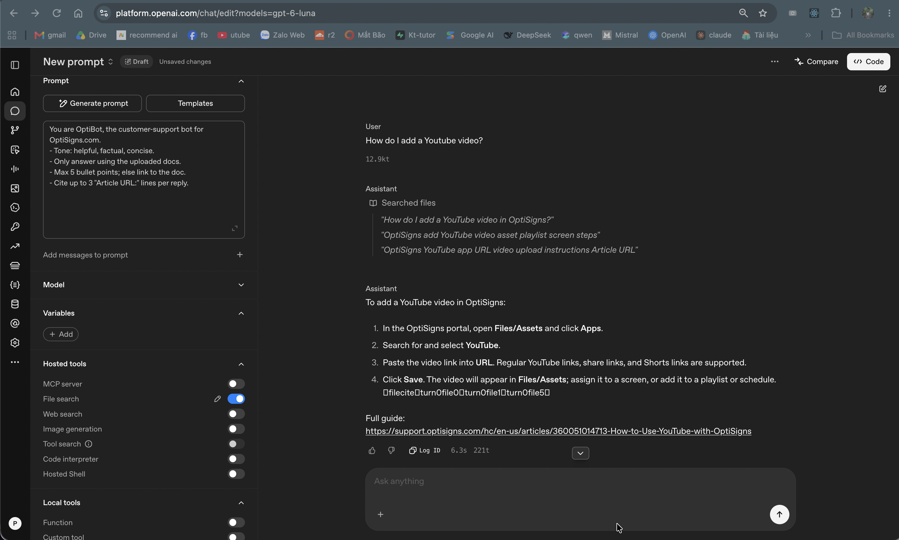
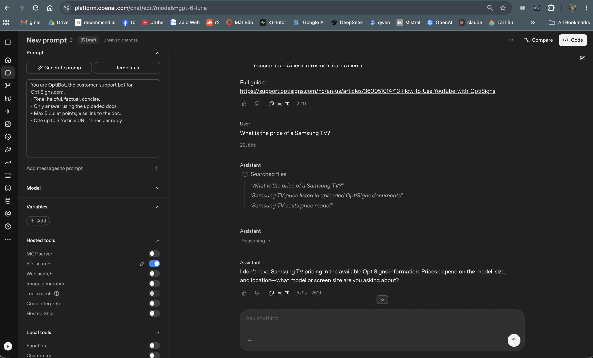

# OptiBot Mini-Clone

Scrapes the OptiSigns help center, converts every article to clean Markdown, and keeps an OpenAI vector store in sync once a day. Only new or changed articles are re-uploaded.

## Setup

1. Python 3.11: `pip install -r requirements.txt`
2. Copy `.env.sample` to `.env` and set `OPENAI_API_KEY` and `VECTOR_STORE_ID`.
   No store yet? Leave `VECTOR_STORE_ID` empty and run `python -m store.openai_store` to create one.

## Run locally

Full sync:

```bash
python main.py
```

Quick test on the first 30 articles (optional):

```bash
ARTICLE_LIMIT=30 python main.py
```

With Docker (runs once, exits 0):

```bash
docker build -t optibot-sync .
docker run --rm -e OPENAI_API_KEY=... -e VECTOR_STORE_ID=... optibot-sync
```

Tests:

```bash
pytest
```

## How it works

- **Scrape:** Zendesk Help Center API (paginated, 415 articles) → HTML cleaned with BeautifulSoup → Markdown in [`articles/`](articles). Headings, links, code blocks and images are kept; in-page anchors are rewritten so table-of-contents links still work.
- **Sync:** each file stores `article_id`, a SHA-256 of its exact uploaded content, and a hash of the chunking config in its vector-store attributes. Every run uploads only new/changed articles, removes the old version after the new one is indexed, and removes articles deleted from Zendesk (only when the full article list was fetched).
- **Log:** the last line of every run is one JSON object: `added`, `updated`, `skipped`, `removed`, `failed`, `chunks_uploaded`, `files_in_store`, `chunks_in_store`.

## Chunking

Static chunks of 600 tokens with 200 overlap (~2,500 / ~830 characters on this corpus). The median article is ~1,000 tokens, so most articles split into 2–3 chunks that each hold one full section, and 30% fit in a single chunk. OpenAI's default 800/400 repeats half of every chunk. (Corpus statistics computed with AI-assisted scripts.)

## Tests

`pytest` runs 30 offline tests (no network, no API key): HTML cleaning on a real article fixture, Markdown conversion, file rendering and hashing, and the sync decisions (add / update / skip / remove, incomplete-fetch guard).

## Daily job

GitHub Actions ([workflow](.github/workflows/daily-sync.yml)) builds the Docker image and runs it every day at 00:00 UTC. Logs are public and each run keeps `run.log` as an artifact.

Latest run log: _TODO: add link_

## Assistant

Configured in the OpenAI dashboard (Chat, Responses API) with the required system prompt and the File search tool on this vector store. The Assistants API was shut down on 2026-08-26, so it cannot be used.




## Findings and known limitations

- **No chunk count from OpenAI.** The API does not return how many chunks a file produced. I count real chunks with a vector-store search filtered to one file (1,430 real vs 1,365 estimated). This is based on testing, not a documented guarantee, and is capped at 50 chunks per file.
- **Dirty source HTML.** AI-assisted scans of all 415 outputs (not just one sample), plus a before/after word and image diff, revealed base64 images, images inside tables, embedded iframes (Canva/YouTube) and table-based NOTE/TIP boxes. All are handled without losing any text.
- **Unstable attribute updates.** `vector_stores.files.update` returned HTTP 500 for several hours (diagnosed with AI-assisted test runs: reproduced with raw HTTP and a fresh store; also reported on the OpenAI forum). The job tolerates it, recounts missing chunk counts via search, and `update_files_chunks_count` backfills them once the API recovers.
- **Not done yet:** comparing chunking configs (e.g. 400/100, 600/200, 800/400) in separate stores against a small question set, and an upload version with a heading path line per section and no table of contents.
